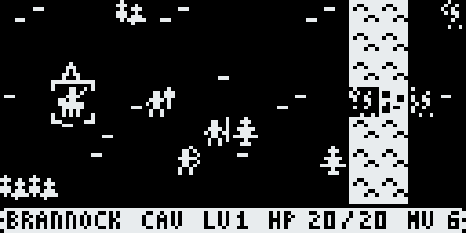
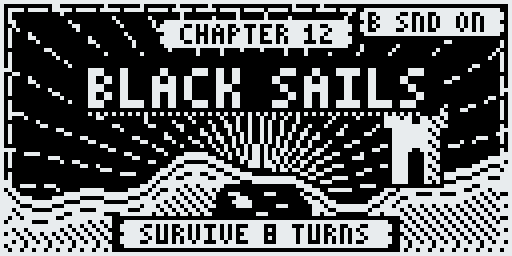
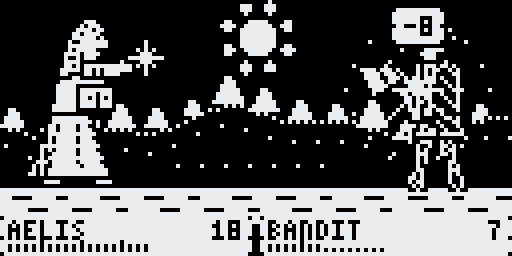
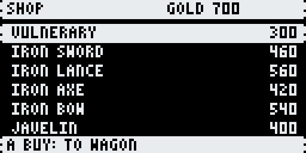
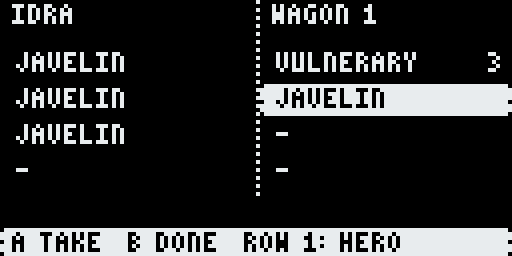
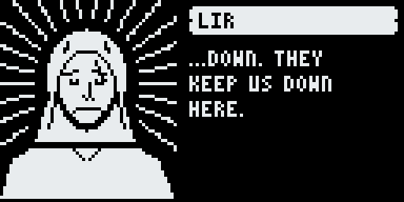

# Undertow — a woodcut tactics game for the Arduboy FX

A border lord chases bandits across a river, and every trail ends in a neighbouring kingdom's silver.
**Undertow** is a Fire Emblem–style tactics game drawn in 1-bit woodcut, for the Arduboy FX and FX-C.

**v0.4:** chapters 1–18 plus six hidden side chapters. That covers the river border, the walls and
vaults of Dainholt, a battle on the deck of a pirate ship, and the island of Vael: a rebellion, the salt
flats and the first demon gate. Four chapters of a planned 22 remain.

| | |
|---|---|
|  |  |
|  |  |
|  |  |
|  |  |
|  |  |
|  |  |
|  |  |
|  |  |

## What's in it
- Turn-based tactics on 24×16 maps: terrain, a weapon triangle (sword > axe > lance > sword), bows at range, double attacks
- **Mages and staves:** Fire, Thunder and Mire tomes hit against half DEF; Sages can attack or heal
- Permadeath with **last words**: every hero gets a death line, so you never miss a loss on the enemy turn
- **Chapter clear screen:** see who fell, then choose ONWARD or RESTART the chapter
- **Gold, shops and a wagon:** villages and bosses pay out, town chapters have a shop on the prep screen, and anything that won't fit in a bag goes to the wagon
- **Fine weapons wear out:** silver weapons, the Killer Bow, Thunder and the Mend staff have uses; iron and steel never break
- **Crits find the gap:** a critical hit never does less than STR + weapon might, so killer weapons can hurt armoured bosses
- **Eight boosters** in the whole game (+2 STR, SKL, SPD or DEF, +5 HP, and one pair of Winged Boots for +1 MOV), hidden where exploring pays
- **Smart staves:** the menu says HEAL or MEND, and the healer uses the weakest staff that covers the wound
- Recruits: rescue captives, and talk enemy soldiers into joining (only the right hero can), including a sea-eagle rider with the widest move in the game
- Hidden side chapters, unlocked by what you do and find in earlier chapters
- A **ship battle**: hold the deck against boarders and things from the sea
- **Hold B for a minimap** that shows every unit as a flashing dot
- Woodcut battle scenes with backgrounds that follow the terrain; EXP, level-ups and promotions (Hero Crests)
- Deployment, trading and item discards before each chapter; sound and music; saves at the start of every chapter

## Files

| File | What it's for |
|---|---|
| `Undertow.arduboy` | everything in one package, for Ardens, RetroArch (Ardens core) and other .arduboy loaders |
| `Undertow-FX.hex` | the game, for the **original Arduboy FX** (and Ardens with default settings) |
| `Undertow-FXC.hex` | the game, for the **Arduboy FX-C / Mini** (and Ardens with `fxport=e2`) |
| `Undertow-data.bin` | the game's FX data, for building a flashcart image (pair it with the matching .hex) |
| `Undertow-dev.bin` | the same data padded for development: load it in Ardens with a .hex, or write it to the end of the flash chip with `fxdata-upload.py` |
| `cart-menu.png` | 128×64 title card for the flashcart menu |

**The FX and FX-C wire the flash chip differently: use the .hex that matches your device.** A big X on
screen with the red LED lit means the FX data is missing or the wrong .hex is loaded.

**Try it in your browser:** drop `Undertow.arduboy` onto the Ardens emulator, or drop
`Undertow-FX.hex` and `Undertow-dev.bin` on it together.

**Adding it to your FX / FX-C cart:** with Mr.Blinky's Arduboy-Python-Utilities:
1. Back up your cart with `flashcart-backup.py`, then unpack it with `flashcart-decompiler.py`.
2. Add a row to the CSV:
   `1;Undertow;Undertow/cart-menu.png;Undertow/Undertow-FXC.hex;Undertow/Undertow-data.bin;;0.4;bitb4nger;Woodcut tactics;`
   Use `Undertow-FX.hex` on an original FX.
3. Rebuild with `flashcart-builder.py` and write it with `flashcart-writer.py`.

**Uploading the .hex directly:** the game is built without USB support (to fit), so the computer can't
reset it into upload mode. Hold **UP + DOWN** for a moment while the game runs to enter the
bootloader, then upload.

## Controls

| Button | Does |
|---|---|
| D-pad | move the cursor |
| A on your unit | show its move range; A again to walk there, then pick an action |
| A on an enemy | show where it can reach and strike |
| A on an empty tile | END TURN, SOUND, RESTART chapter, QUIT to title (UP wraps to the bottom) |
| B | cancel / undo a move; on the map, tap to jump to your next ready unit |
| hold B | minimap |
| hold A | speed up a battle |
| B on a chapter card | sound on/off |

Each unit does one thing per turn: attack, cast, heal, talk, visit, use an item, or wait.

## Changes in v0.4
- Chapters 14–18, plus side chapters 13X and 17X; four new recruits (Saoirse, Thane, Hesk, Lir)
- Crit floor (crits ignore armour down to STR + might), eight stat boosters, smart HEAL/MEND staves
- Armoured bosses (Aldric, the dockmaster) a little less armoured
- Saves from v0.3 carry over: the new heroes are added when you continue

## Changes in v0.3
- Chapters 7–13, plus side chapters 7X and 10X; two new recruits
- Mage → Sage line, tomes, Mend Staff
- Durability on fine weapons; gold, town shops and the wagon; much rarer vulneraries, crests and silver
- Death lines, chapter clear screen with restart, discard items from the trade screen, minimap, wrapping menus
- Smaller music data and a leaner build to make room for all of it

## Feedback
Tell me what's too hard, too easy, confusing, or broken. Chapters 13X–18 are the newest, and the hardest stretch so far.
