# Undertow — a woodcut tactics game for the Arduboy FX

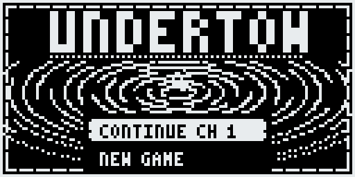

A border lord chases bandits across a river, and every trail ends in a neighbouring kingdom's silver.
**Undertow** is a Fire Emblem–style tactics game drawn in 1-bit woodcut, for the Arduboy FX and FX-C.

**v1.0: the whole campaign.** 22 chapters and seven hidden side chapters: the river border, the walls
and vaults of Dainholt, a battle on the deck of a pirate ship, the island of Vael, the salt marsh, the
last bellwright's foundry, and the drowned cathedral where it ends. How it ends depends on what you
found, who you saved and who is still standing.

| | |
|---|---|
|  | 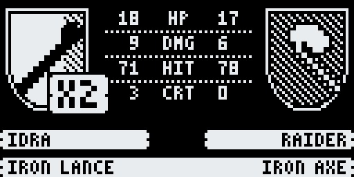 |
| 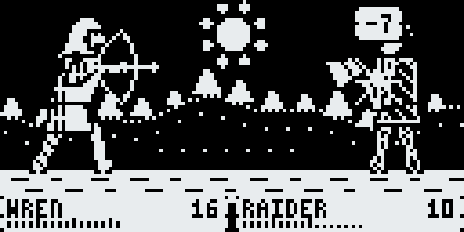 | 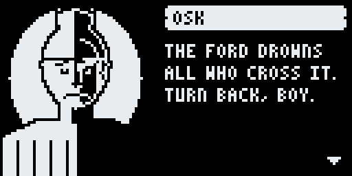 |
|  | 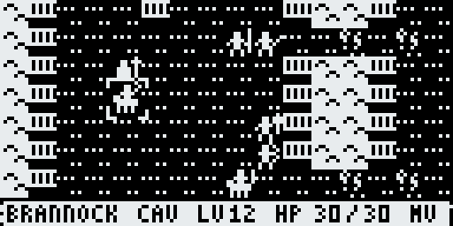 |
| 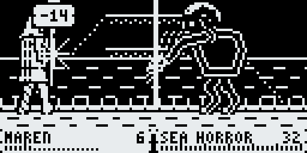 |  |
|  |  |
| 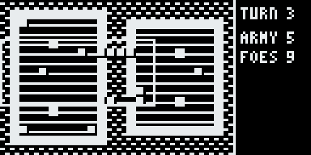 | 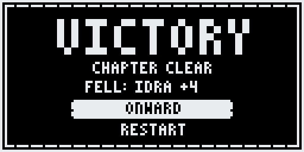 |
| 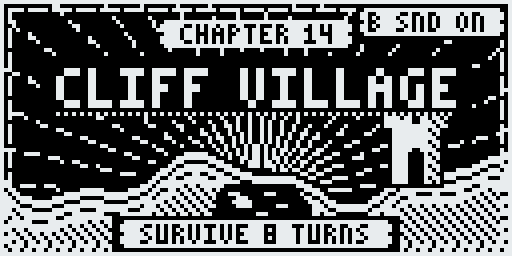 | 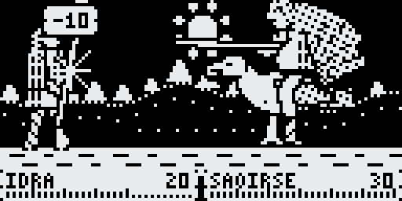 |
| 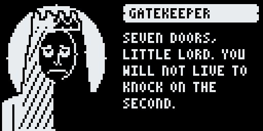 |  |
| 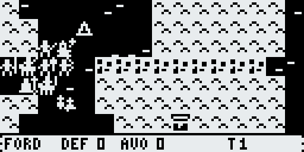 | 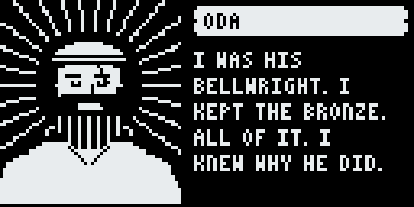 |
| 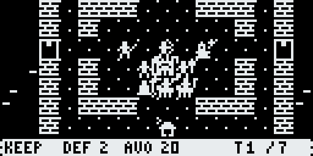 | 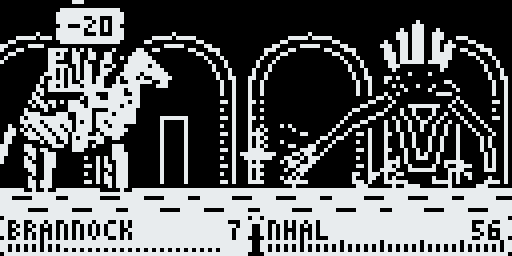 |
| 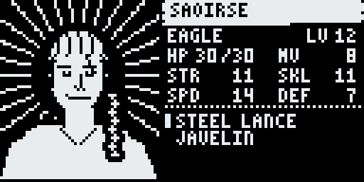 | 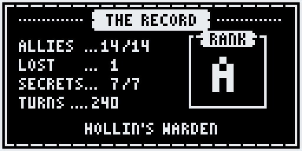 |
| 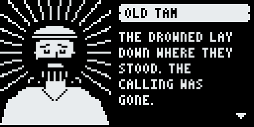 | 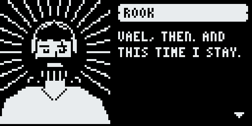 |

## What's in it
- Turn-based tactics on 24×16 maps: terrain, a weapon triangle (sword > axe > lance > sword), bows at range, double attacks
- **Mages and staves:** Fire, Thunder and Mire tomes hit against half DEF; Sages can attack or heal
- Permadeath with **last words**: every hero gets a death line, so you never miss a loss on the enemy turn
- **Chapter clear screen:** see who fell, then choose ONWARD or RESTART the chapter
- **Gold, shops and a wagon:** villages and bosses pay out, town chapters have a shop on the prep screen, and anything that won't fit in a bag goes to the wagon
- **Fine weapons wear out:** silver weapons, the Killer Bow, Thunder and the Mend staff have uses; iron and steel never break
- **Crits find the gap:** a critical hit never does less than STR + weapon might, so killer weapons can hurt armoured bosses
- **Eight boosters** in the whole game (+2 STR, SKL, SPD or DEF, +5 HP, and one pair of Winged Boots for +1 MOV), hidden where exploring pays
- **Smart staves:** the menu says HEAL or MEND, and the healer uses the weakest staff that covers the wound
- Recruits: rescue captives, and talk enemy soldiers into joining (only the right hero can), including a sea-eagle rider with the widest move in the game
- Hidden side chapters, unlocked by what you do and find in earlier chapters
- A **ship battle**: hold the deck against boarders and things from the sea
- **Hold B for a minimap** that shows every unit as a flashing dot
- Woodcut battle scenes with backgrounds that follow the terrain; EXP, level-ups and promotions (Hero Crests)
- Deployment, trading and item discards before each chapter; sound and music; saves at the start of every chapter
- **Status cards** for any unit: portrait, class, stats, EXP and items (and which of an enemy's items it drops)
- **Endings that follow your choices:** who rings the sealing bell, what becomes of the Drowned, a coda for every
  survivor, an epitaph for every hero lost, then **the record**: allies, losses, secrets and turns, and a rank
- **A save that survives other games:** it's kept in the game's own block of the FX flash as well as EEPROM

## Files (in [`release/`](release))

| File | What it's for |
|---|---|
| `Undertow.arduboy` | everything in one package, for Ardens, RetroArch (Ardens core) and other .arduboy loaders |
| `Undertow-FX.hex` | the game, for the **original Arduboy FX** (and Ardens with default settings) |
| `Undertow-FXC.hex` | the game, for the **Arduboy FX-C / Mini** (and Ardens with `fxport=e2`) |
| `Undertow-data.bin` | the game's FX data, for building a flashcart image (pair it with the matching .hex) |
| `Undertow-save.bin` | the game's empty 4 KB save block, for the flashcart image's save column |
| `Undertow-dev.bin` | data and save block padded for development: load it in Ardens with a .hex, or write it to the end of the flash chip with `fxdata-upload.py` |
| `cart-menu.png` | 128×64 title card for the flashcart menu |

**The FX and FX-C wire the flash chip differently: use the .hex that matches your device.** A big X on
screen with the red LED lit means the FX data is missing or the wrong .hex is loaded.

**Try it in your browser:** drop `Undertow.arduboy` onto the Ardens emulator, or drop
`Undertow-FX.hex` and `Undertow-dev.bin` on it together.

**Adding it to your FX / FX-C cart:** with Mr.Blinky's Arduboy-Python-Utilities:
1. Back up your cart with `flashcart-backup.py`, then unpack it with `flashcart-decompiler.py`.
2. Add a row to the CSV:
   `1;Undertow;Undertow/cart-menu.png;Undertow/Undertow-FXC.hex;Undertow/Undertow-data.bin;Undertow/Undertow-save.bin;1.0;bitb4nger;Woodcut tactics;`
   Use `Undertow-FX.hex` on an original FX.
   **v1.0 needs the save file in that row**: without it the cart has no save block for the game.
3. Rebuild with `flashcart-builder.py` and write it with `flashcart-writer.py`.

**Uploading the .hex directly:** the game is built without USB support (to fit), so the computer can't
reset it into upload mode. Hold **UP + DOWN** for a moment while the game runs to enter the
bootloader, then upload.

## Controls

| Button | Does |
|---|---|
| D-pad | move the cursor |
| A on your unit | show its move range; A again to walk there, then pick an action |
| A on a unit that has acted (or a captive) | its status card (LEFT/RIGHT: the next one) |
| A on an enemy | show where it can reach and strike; A again for its status card |
| A on an empty tile | END TURN, ARMY (status cards), SOUND, RESTART chapter, QUIT to title (UP wraps to the bottom) |
| RIGHT on the deployment list | that hero's status card |
| B | cancel / undo a move; on the map, tap to jump to your next ready unit |
| hold B | minimap |
| hold A | speed up a battle |
| B on a chapter card | sound on/off |

Each unit does one thing per turn: attack, cast, heal, talk, visit, use an item, or wait.

## Source, building and licence
Everything that makes the game is here: the engine (`Undertow.ino`), the chapter files (`chapters/`),
the data, art and sound generators (`tools/`) and a PC test harness (`tools/sim/`).
**[DEVELOPING.md](DEVELOPING.md)** has the build steps (`tools/build_hex.sh` and `tools/build_data.sh`
reproduce `release/`; see `release/SHA256SUMS.txt` and which compiler made it), what the game does with
EEPROM and the FX save block, and how chapters are written.
MIT licensed (`LICENSE`): change anything, share it, build on it.

## Changes in v1.0
- **The rest of the campaign:** Ch 19 Swamp of Death, side chapter 19X The Great Bell (and Oda, the last
  bellwright), Ch 20 The Long Rain, Ch 21 Blood Fortress (the Hollow King) and Ch 22 The Demon Portal (Nhal)
- **Endings:** the finale's outcome follows the side chapters you found and who survived, with a coda for every
  survivor, an epitaph for every hero lost, and the record and a rank after it
- **Status cards** for heroes and enemies (and an ARMY entry in the game menu)
- **More silver:** fine weapons from villages and bosses from Ch 13 on, about one for every fighter by the end
- Fixed: the E (equipped) and the uses count no longer overlap in the item list
- Fixed: the deployment count never shows more places than the army can fill (5/5, not 5/6)
- The save is mirrored to the game's own FX flash block and restored at power-on, so other games writing to
  EEPROM can't erase it (the cart needs the new save file; see above)
- A leaner sound player of its own, which made room for all of this
- Saves from v0.4 carry over (Oda is added when you continue; the turn count for the rank starts from
  where you are). If you'd reached v0.4's "to be continued", CONTINUE replays Ch 18 and goes on to Ch 19

## Changes in v0.4
- Chapters 14–18, plus side chapters 13X and 17X; four new recruits (Saoirse, Thane, Hesk, Lir)
- Crit floor (crits ignore armour down to STR + might), eight stat boosters, smart HEAL/MEND staves
- Armoured bosses (Aldric, the dockmaster) a little less armoured
- Saves from v0.3 carry over: the new heroes are added when you continue

## Changes in v0.3
- Chapters 7–13, plus side chapters 7X and 10X; two new recruits
- Mage → Sage line, tomes, Mend Staff
- Durability on fine weapons; gold, town shops and the wagon; much rarer vulneraries, crests and silver
- Death lines, chapter clear screen with restart, discard items from the trade screen, minimap, wrapping menus
- Smaller music data and a leaner build to make room for all of it

## Feedback
Tell me what's too hard, too easy, confusing, or broken, and which ending you got. Chapters 19–22 are the newest:
the finale is meant to be the hardest fight in the game, and much harder if you skipped both 17X and 19X.
